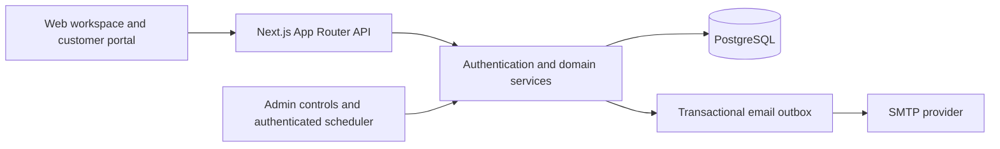

# LoopLedger

**From quotation to the next billing cycle, with every charge explained.**

LoopLedger is a subscription operations platform built for **Odoo x Make-A-Ton 9.0, Kochi 2026**. It brings product configuration, quotations, recurring contracts, invoices, received payments and customer self-service into one connected workflow.

**[Live demo](https://loopledger-demo.vercel.app)** · **[Repository](https://github.com/Devadathan69/make-a-ton)** · **[Demo walkthrough](docs/DEMO_RECORDING.md)**

## What LoopLedger does

Subscription teams need to answer three questions: what should be billed, why that amount was charged, and what is still outstanding. LoopLedger connects those answers to the original contract and its billing history.

- **Configure the offering:** software, services and add-ons; product variants; four billing intervals; taxes; fixed or percentage discounts; availability and lifecycle policies.
- **Turn an offer into a contract:** manage customer contacts, reuse quotation templates, save drafts, set validity dates, and confirm or activate subscriptions.
- **Keep billing consistent:** snapshot contract prices and tax rates, generate recurring periods transactionally, catch up missed periods, and prevent duplicate invoices.
- **Explain every invoice:** show line quantities, prices, discounts, taxes and totals alongside the stored calculation explanation. Open an authorized printable invoice and save it as PDF through the browser.
- **Record and reconcile receipts:** record bank-transfer, UPI, card, cash or other payments already received; track partial settlement, outstanding amounts and overdue balances. Retry uncertain requests using the same payment intent.
- **See the financial picture:** filter billed amounts and collections by date, inspect current outstanding and overdue balances, and view normalized recurring value before tax.
- **Give customers their own workspace:** customers see only their subscriptions, invoices and documents, with self-service actions governed by their contract policies.
- **Send account and invoice notifications:** SMTP-backed password-reset links and invoice emails use a transactional outbox with delivery state, retry handling and encrypted reset payloads.

## Roles and access

| Role | Workspace access |
| --- | --- |
| **Admin** | Catalog and rule configuration, staff provisioning, customer and subscription operations, invoicing, payments, reports, billing controls and outbox administration. |
| **Staff** | Read-only catalog access; customer, template and subscription operations; invoice actions, payment recording and reports. |
| **Customer** | Own portal records and authorized invoice documents; permitted pause, resume, renew and close actions. |

Permissions and record ownership are enforced by the server. Authentication uses salted scrypt password hashes and opaque server-backed sessions with HttpOnly cookies. Mutation requests use origin and CSRF checks.

## Subscription and billing workflow

```text
DRAFT → QUOTATION → CONFIRMED → ACTIVE → CLOSED
                                  ↕
                                PAUSED
```

Actions depend on the actor, effective date and plan policy. Confirmation fixes the contract's prices, variants, tax rates and billing policies. Monthly and yearly schedules preserve their calendar anchor, including month-end and leap-year cases.

Pause stops future unissued periods; existing invoices remain collectible. Resume starts a fresh cycle without refunding unused time. Finite expiry must align with a billing boundary. A permitted renewal of a closed contract requires an explicit future cycle start.

Money is stored and calculated in **integer paise**; percentage rates use **basis points**, with BigInt intermediates for exact calculations. Discounts have inclusive validity dates, thresholds and global usage caps. Taxes apply to the discounted line amounts, and invoice lines reconcile with the header totals.

For example, the supplied 10-seat scenario produces:

| Calculation | Amount |
| --- | ---: |
| Subtotal | ₹10,000 |
| Discount | −₹1,000 |
| Illustrative tax | ₹900 |
| **Invoice total** | **₹9,900** |
| First received payment | ₹4,000 |
| Remaining balance | ₹5,900 |

The isolated **demo clock** runs the same billing service used by the scheduler endpoint. It makes subsequent cycles and discount expiry visible without changing the machine clock. The interface labels simulated dates explicitly.

## Architecture

LoopLedger runs as a single Next.js application with a PostgreSQL-backed API.



| Layer | Technology |
| --- | --- |
| Application | Next.js 16, React 19, TypeScript |
| Interface | CSS Modules and shared accessible components |
| Data and validation | PostgreSQL 17, `pg`, Zod |
| Notifications | Nodemailer, TLS SMTP, transactional outbox |
| Verification | Vitest, ESLint, TypeScript, connected PostgreSQL and Chromium checks |
| Hosting | Vercel and Neon PostgreSQL |

```text
src/app/                 Pages, protected layouts and API routes
src/features/auth/       Authentication and staff management
src/features/catalog/    Products, plans, tax and discount configuration
src/features/subscriptions/ Customers, templates, quotations and lifecycle UI
src/features/finance/     Dashboard, invoices and received payments
src/features/portal/      Customer self-service
src/server/              Permissions, repositories, billing and reporting
src/lib/                 Shared contracts, API facade and formatting
src/components/          Shared UI, dialogs and operations controls
db/migrations/           Ordered, checksum-checked SQL migrations
scripts/                 Migration, seed, smoke, benchmark and demo tooling
docs/                    Implementation, setup and recording guides
```

## Run locally

### Prerequisites

- **Node.js 24** and npm.
- **Docker with Compose** for the local PostgreSQL service, or an existing PostgreSQL 17 installation.
- Git.

### 1. Get the source

```bash
git clone https://github.com/Devadathan69/make-a-ton.git
cd make-a-ton
npm ci
```

### 2. Start PostgreSQL

The following commands use Bash. The database password is prompted privately and supplied to Compose through the environment.

```bash
read -r -s -p "Choose a local database password: " POSTGRES_PASSWORD
export POSTGRES_PASSWORD
docker compose up -d db
docker compose exec db pg_isready -U loopledger -d loopledger_demo
```

Wait for PostgreSQL to report that it is accepting connections. Compose binds the database to `127.0.0.1:5432` and stores its data in the `loopledger-demo-data` volume. Retain the same database password when reusing that volume.

### 3. Configure the connected application

```bash
export DATABASE_URL="$(node -e 'process.stdout.write("postgresql://loopledger:" + encodeURIComponent(process.env.POSTGRES_PASSWORD) + "@127.0.0.1:5432/loopledger_demo")')"
export MIGRATION_DATABASE_URL="$DATABASE_URL"
export NEXT_PUBLIC_DATA_MODE=http
export APP_URL=http://localhost:3000
export ENABLE_DEMO_SEED=true
export ENABLE_DEMO_CLOCK=true
export DEMO_DATABASE_NAME=loopledger_demo

read -r -s -p "Choose a synthetic demo account password: " DEMO_PASSWORD
export DEMO_PASSWORD
```

The demo password must contain at least nine characters, including uppercase, lowercase and a special character. Digits are optional.

### 4. Migrate, seed and start

```bash
npm run db:migrate
npm run db:seed
npm run build
npm start
```

Open **http://localhost:3000**. The connected workspace shows **Connected API** and a **SIMULATION** date label.

The local seed creates fictitious accounts for `admin@example.test`, `staff@example.test`, `ananya@example.test` and `arjun@example.test`, using the privately supplied `DEMO_PASSWORD`. Hosted demo credentials are shared separately. Creating a business contact in the customer screen does not create a login account.

Migrations and seeding can be rerun: migration checksums are checked, and the seed preserves existing records and passwords. The local seed requires an opted-in loopback database whose name contains `demo` or `test`.

For PowerShell commands, native PostgreSQL setup and hosted bootstrap instructions, see [Local and hosted demo setup](docs/LOCAL_DEMO.md). With an existing PostgreSQL installation, supply its private connection URLs and follow the configuration, migration and seed steps above.

For development with fixture data only, set `NEXT_PUBLIC_DATA_MODE=mock` and run `npm run dev`. Mock data is temporary browser-memory state. Use `http` mode for authentication, persisted records, billing and payment workflows; HTTP errors never fall back to fixtures.

## Environment configuration

Use private process environment variables or an untracked `.env.local` file. [.env.example](.env.example) lists the supported settings.

| Variable | Purpose |
| --- | --- |
| `NEXT_PUBLIC_DATA_MODE` | `http` for the connected application; set at build and runtime. `mock` selects the development adapter. |
| `DATABASE_URL` | Private PostgreSQL runtime connection URL. |
| `MIGRATION_DATABASE_URL` | Direct/unpooled URL for migrations. `DATABASE_URL_UNPOOLED` is also recognized; otherwise the runner uses `DATABASE_URL`. |
| `APP_URL` | Exact application origin, such as `http://localhost:3000` locally or `https://loopledger-demo.vercel.app` for the hosted demo. |
| `POSTGRES_PASSWORD` | Private password consumed by the local Compose database service. |
| `ENABLE_DEMO_SEED`, `DEMO_PASSWORD` | Explicit local demo-seed opt-in and synthetic account password. |
| `ENABLE_DEMO_CLOCK`, `DEMO_DATABASE_NAME` | Enable simulation only for the matching isolated demo/test database. |
| `SMTP_HOST`, `SMTP_PORT`, `SMTP_USER`, `SMTP_PASSWORD`, `SMTP_FROM` | Provider connection, authentication and sender configuration. |
| `EMAIL_DELIVERY_ENABLED` | Set to `true` to enable configured SMTP delivery. |
| `OUTBOX_ENCRYPTION_KEY` | Private 32-byte hex key used to encrypt password-reset email payloads. |
| `CRON_SECRET` | Independent server-side scheduler bearer credential, at least 32 characters. |
| `DB_TEST_URL` | Disposable direct PostgreSQL demo/test database for connected tests. |
| `APP_HOST` | Optional intentional host binding for `npm start`; defaults to `127.0.0.1`. |

Keep database URLs, account passwords, encryption keys and SMTP credentials out of Git and `NEXT_PUBLIC_*` variables.

### Email notifications

LoopLedger implements invoice email and single-use password-reset links through its SMTP outbox. Configure the SMTP variables, a matching `APP_URL`, `OUTBOX_ENCRYPTION_KEY` and `EMAIL_DELIVERY_ENABLED=true`. Port `587` uses STARTTLS; port `465` uses TLS.

Outbox states are **QUEUED**, **SENT**, **FAILED** and **UNCERTAIN**. Admins can inspect failures and retry messages. `SENT` records SMTP acceptance; uncertain outcomes require reconciliation before retrying. Targeted request-lifecycle processing handles reset and explicit invoice-send requests after their database work commits.

### Billing operations

Admins can run due billing and advance the isolated demo clock from `/operations`. The authenticated `GET`/`POST /api/v1/scheduler/run` endpoint supports a deployment scheduler, bounded catch-up batches and retry-safe recurring periods.

The repository includes `vercel.example.json`, a scheduler workflow and `npm run billing:catchup`. Configure the chosen dispatcher for the deployment; see [Vercel and Neon guidance](docs/VERCEL_NEON.md) for connection pooling, scheduler cadence and backlog handling.

## Verification

The integrated application has **118 passing automated tests**, covering authentication, permissions, calendar boundaries, exact pricing, lifecycle transitions, recurring billing, invoice ownership and payment concurrency. Browser verification includes **20 connected workflow scenarios** and **13 authentication, role and responsive-layout checks**. The deployed application also passed **29 read-only smoke checks**.

```bash
npm run lint
npm run typecheck
npm test
npm run build
# Run all four checks:
npm run check
```

Set `DB_TEST_URL` to a disposable direct PostgreSQL database named with `demo` or `test` to include the connected suites. Without it, those suites are skipped. Test schemas are isolated; keep the recording database separate from test and performance data.

| Command | Purpose |
| --- | --- |
| `npm run dev` | Start the development server. |
| `npm run smoke` | Check liveness, readiness and protected routes; optionally include local synthetic login checks. |
| `npm run qa:browser` | Run local Chromium authentication, role and responsive checks. |
| `npm run qa:integration` | Exercise the connected demo, payment retry failures and lifecycle flows on a fresh local seed. |
| `npm run db:seed:performance` | Add 5,000 subscriptions to a separate local performance database. |
| `npm run benchmark` | Measure local production-build API latency. |
| `npm run deploy:manifest` | Produce a clean-checkout source manifest excluding environment files, dependencies and generated output. |

Browser scripts require Playwright and Chromium, with optional `PLAYWRIGHT_MODULE_PATH` and `CHROMIUM_PATH` settings. Smoke and benchmark targets use `SMOKE_BASE_URL` and `BENCHMARK_BASE_URL`; browser checks use `QA_BASE_URL`.

A local production-build benchmark with **5,007 subscriptions and 1,066 invoices** measured API p95 of approximately **41 ms** for subscriptions, **80 ms** for reports and **9 ms** for invoices. Measured page p95 was **675–716 ms**. These are local measurements; benchmark conditions and workflow evidence are documented in [Core status](docs/CORE_STATUS.md).

Health endpoints: `/api/health` reports application liveness and mode; `/api/ready` checks database readiness in connected mode.

## Team

| Member | Contribution |
| --- | --- |
| **[Devadathan M R](https://github.com/Devadathan69)** | Core platform, authentication, data model, business rules, billing, payment/report services, integration and verification. |
| **[Athul](https://github.com/Athul276)** | Product and variant catalog, plans, tax and discount configuration interfaces. |
| **[Hannath M.A](https://github.com/HannathMA)** | Customers, quotation templates/composer, subscription interfaces and customer portal. |
| **Adrinath S Binod** | Finance dashboard, invoice and payment-history interfaces. |

Individual contributions and integration changes are preserved in the repository's commit history.

## Documentation

- [Implementation plan and business policies](docs/IMPLEMENTATION_PLAN.md)
- [Local setup and demo data](docs/LOCAL_DEMO.md)
- [Functional recording walkthrough](docs/DEMO_RECORDING.md)
- [Deployment configuration](docs/DEPLOYMENT.md)
- [Vercel and Neon compatibility](docs/VERCEL_NEON.md)
- [Implementation and verification evidence](docs/CORE_STATUS.md)
- [Contribution and ownership guidelines](AGENTS.md)
